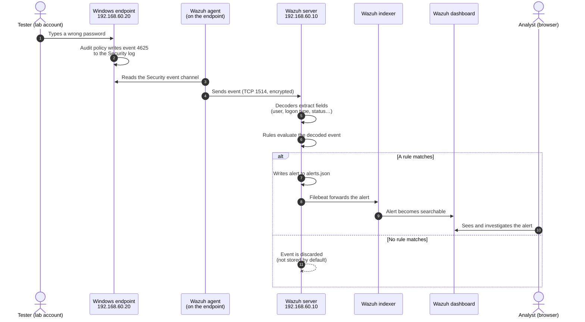

# Telemetry Data Flow — From Event to Alert

**Sprint 1 · Milestone 1B** · Status: **Proposed** · 2026-11-11

This document follows one event from the moment it happens on an endpoint to the moment an analyst sees an alert. It also lists **where the chain can break**, so that when a detection "doesn't fire" in later phases we can check each stage in order instead of guessing.

> Legend: **[Verified-doc]** = confirmed in official documentation (see Sources) · **[To verify]** = must be confirmed on the real lab in Phase 2/3

---

## 1. The journey in one picture

Worked example: **a failed Windows logon** (candidate scenario: repeated failed logons).



## 2. Stage by stage

| # | Stage | Where | What happens | Source |
|---|---|---|---|---|
| 1 | **Behaviour** | Endpoint | Something happens, e.g. a failed logon | — |
| 2 | **OS logging** | Endpoint | Windows writes event **4625** ("An account failed to log on") to the **Security** channel, but only if the *Audit Logon* policy is enabled | Verified-doc (Microsoft) |
| 3 | **Collection** | Agent | The agent's log collector reads the configured sources: Windows event channels (`Security`, `Microsoft-Windows-Sysmon/Operational`) or Linux log files | Verified-doc (Wazuh) |
| 4 | **Transport** | Network | The agent sends events to the server on **TCP 1514** over an encrypted, enrolled connection | Verified-doc (Wazuh) |
| 5 | **Decoding** | Server | Decoders recognise the log type and pull out fields (user name, IP, event ID…) | Verified-doc (Wazuh) |
| 6 | **Rule matching** | Server | The analysis engine checks decoded events against rules (built-in + our custom ones) | Verified-doc (Wazuh) |
| 7 | **Alert written** | Server | Matching events become alerts in `/var/ossec/logs/alerts/alerts.json` | Verified-doc (Wazuh) |
| 8 | **Indexing** | Server → Indexer | Filebeat forwards alerts to the Wazuh indexer | Verified-doc (Wazuh) |
| 9 | **Visualisation** | Dashboard | The analyst searches and investigates the alert in the browser | Verified-doc (Wazuh) |

### Collection config this implies (Windows agent)

```xml
<localfile>
  <location>Security</location>
  <log_format>eventchannel</log_format>
</localfile>

<localfile>
  <location>Microsoft-Windows-Sysmon/Operational</location>
  <log_format>eventchannel</log_format>
</localfile>
```

According to Wazuh's documentation the Security channel is collected by default; the Sysmon block must be added. Confirming the exact defaults on the installed agent is **[To verify]** in Phase 3.

### Linux side

Ubuntu Server 24.04 authentication events (e.g. SSH failures) may be written to `/var/log/auth.log` by rsyslog and/or the systemd journal. Which source the agent should read is **[To verify]** on the real VM in Phase 3. We do not assume a path in advance.

## 3. ⚠️ Key design consequence: "no alert" ≠ "no event"

By default, Wazuh **does not store events that don't match a rule**. The `logall` and `logall_json` settings, which write every event to `/var/ossec/logs/archives/`, both default to `no`. [Verified-doc]

So if a test produces **no alert**, there are two very different explanations:

1. **The event never arrived.** This is a telemetry problem in stages 2–4.
2. **The event arrived but no rule matched.** This is a detection problem in stages 5–6.

From the dashboard alone, these two cases look identical. The validation method (Phase 5) must therefore be able to see raw events. Options to decide later:
- enable `logall_json` **temporarily** during validation runs (costs disk space, so switch it off afterwards), or
- confirm the event on the endpoint itself (Event Viewer / log file) and compare.

This is recorded as a decision to make in Phase 5, not now.

## 4. Where the chain can break — troubleshooting checklist

Work **top to bottom**: there's no point debugging a rule if the event never left the endpoint.

| # | Check | How (planned) | Typical cause if it fails |
|---|---|---|---|
| 1 | Did the behaviour happen? | Note the exact action + timestamp | Test step not performed as written |
| 2 | Did the OS log it? | Event Viewer → Security, look for 4625 at that time | Audit policy not enabled |
| 3 | Is the agent collecting that source? | Agent config + agent log | `localfile` missing, wrong channel name |
| 4 | Is the agent connected? | Agent status in dashboard / on server | Network, firewall, VPN, wrong server IP |
| 5 | Did the server receive it? | Archives (if enabled) | Transport/enrollment problem |
| 6 | Did a decoder parse it? | Wazuh rule-testing tool **[To verify: name/usage]** | Unusual log format |
| 7 | Did a rule match? | Rule-testing tool / alerts.json | Rule logic, field names, thresholds |
| 8 | Is the alert in the dashboard? | Search by time and agent | Indexer/Filebeat issue, wrong time filter |

## 5. Sources

- Wazuh, "Wazuh server" (components, Filebeat role) — https://documentation.wazuh.com/current/getting-started/components/wazuh-server.html (accessed 2026-11-11)
- Wazuh, "Log data collection — How it works" (alerts and archives paths) — https://documentation.wazuh.com/current/user-manual/capabilities/log-data-collection/how-it-works.html (accessed 2026-11-11)
- Wazuh, "Log data collection — Configuration" (eventchannel snippets) — https://documentation.wazuh.com/current/user-manual/capabilities/log-data-collection/configuration.html (accessed 2026-11-11)
- Wazuh, "ossec.conf — global" (`logall`, `logall_json` defaults) — https://documentation.wazuh.com/current/user-manual/reference/ossec-conf/global.html (accessed 2026-11-11)
- Wazuh, "Architecture" (agent port 1514) — https://documentation.wazuh.com/current/getting-started/architecture.html (accessed 2026-11-11)
- Microsoft Learn, "4625(F) An account failed to log on" — https://learn.microsoft.com/en-us/previous-versions/windows/it-pro/windows-10/security/threat-protection/auditing/event-4625 (accessed 2026-11-11)
