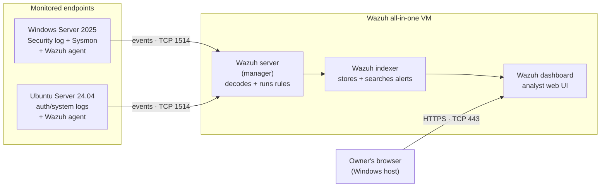
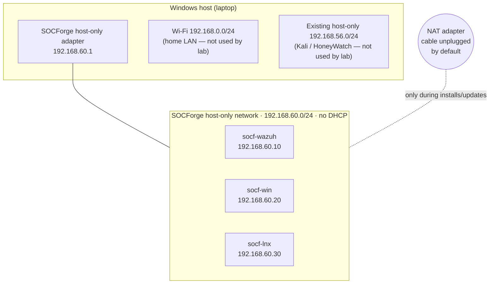

# Lab Architecture — Blueprint & Network Plan

**Sprint 1 · Milestone 1A** · Status: **Proposed, awaiting owner approval** · 2026-11-11

Nothing in this document has been built yet. It is the plan that Phase 2 (Wazuh deployment) and Phase 3 (endpoints) will follow.

---

## 1. The lab in one picture (logical view)

What talks to what, and why.

| Piece | Job in one line |
|---|---|
| **Agent** | Reads logs on the endpoint and ships them to the server |
| **Wazuh server (manager)** | Receives events, checks them against rules, and creates alerts when a rule matches |
| **Wazuh indexer** | A search database that stores alerts so they can be queried |
| **Wazuh dashboard** | The web page used to view and investigate alerts |

## 2. Network plan (physical view)

### Why this design
- **New, separate network.** SOCForge VMs can't reach the Kali or HoneyWatch VMs on 192.168.56.0/24, so the experiments don't contaminate each other.
- **Host-only, not bridged.** Lab VMs are invisible to the home Wi-Fi and the internet.
- **Static IPs, no DHCP.** Each VM keeps the same address every time it boots, so logs and alerts always show the same IP for the same machine. That makes investigation and timelines easier.
- **NAT "unplugged" by default.** Each VM has a second, internet-facing adapter, with the virtual cable disconnected unless we need it. It gets plugged in only for package installs, updates, or Windows activation, then unplugged again.

### IP address plan

| Host | Address | Role |
|---|---|---|
| Windows host | 192.168.60.1 | Owner's browser → dashboard |
| `socf-wazuh` | 192.168.60.10 | Wazuh server + indexer + dashboard |
| `socf-win` | 192.168.60.20 | Windows endpoint |
| `socf-lnx` | 192.168.60.30 | Linux endpoint |

Subnet check (2026-11-11, read-only): the host already uses 192.168.0.0/24 (Wi-Fi), 192.168.56.0/24 (existing VirtualBox host-only) and 10.2.0.0 (VPN tunnel). **192.168.60.0/24 does not overlap with any of these.**

### Allowed traffic

| From | To | Port | Why |
|---|---|---|---|
| Agents (.20, .30) | Wazuh server (.10) | TCP 1514 | Send events |
| Agents (.20, .30) | Wazuh server (.10) | TCP 1515 | One-time agent enrollment |
| Host (.1) | Wazuh dashboard (.10) | TCP 443 | Analyst web UI |
| Host (.1) | Wazuh server (.10) | TCP 55000 | Wazuh API (optional, for scripted validation later) |

Everything else between lab VMs is unnecessary for the core scenarios. Indexer ports 9200 and 9300–9400 stay internal to the Wazuh VM because this is a single-node deployment.

## 3. VM roles & resources

| VM | OS | vCPU | RAM | Disk (max, dynamic) | Location |
|---|---|---|---|---|---|
| `socf-wazuh` | Ubuntu Server 24.04 LTS | 4 | 8 GiB | 50 GB | `D:\SOCForge-VMs\` |
| `socf-win` | Windows Server 2025 Eval (Desktop Experience) | 2 | 4 GiB | 50 GB (SATA) | `D:\SOCForge-VMs\` |
| `socf-lnx` | Ubuntu Server 24.04 LTS | 2 | 2 GiB | 20 GB | `D:\SOCForge-VMs\` |

### Run profiles (Option B — one endpoint at a time)

| Profile | VMs running | RAM used by VMs | Left for host (of 15.2 GiB) |
|---|---|---|---|
| **W** — Windows tests | wazuh + win | 12 GiB | ~3.2 GiB → close heavy apps (browser tabs, etc.) |
| **L** — Linux tests | wazuh + lnx | 10 GiB | ~5.2 GiB |

## 4. Risks & assumptions

| Item | Type | Note |
|---|---|---|
| Profile W leaves ~3 GiB for the host | Risk | Monitor host RAM during tests; Windows VM may drop to 3 GiB if needed |
| VPN may block local traffic | Assumption | Some VPN "kill switch" settings block LAN/host-only traffic; check before Phase 2 |
| Windows hypervisor layer active (WSL2) | Limitation | VirtualBox runs slower on top of it; recorded in the Phase 0 report |
| Ubuntu Server 24.04 for both Linux VMs | Decision (pending) | Listed as supported by Wazuh; endpoint log paths verified in Phase 3 |

## 5. Sources

- Wazuh, "Quickstart" (requirements, supported OS) — https://documentation.wazuh.com/current/quickstart.html (accessed 2026-11-11)
- Wazuh, "Architecture" (required ports) — https://documentation.wazuh.com/current/getting-started/architecture.html (accessed 2026-11-11)
- Microsoft Learn, "Hardware Requirements for Windows Server" — https://learn.microsoft.com/en-us/windows-server/get-started/hardware-requirements (accessed 2026-11-11)
